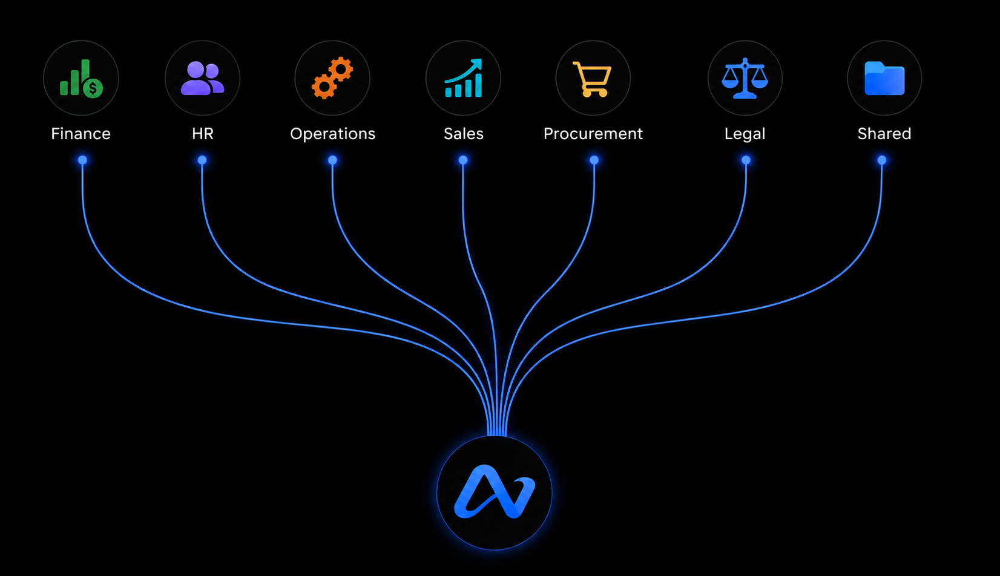

# back-office-agents

[](https://opensource.org/licenses/MIT)
[](https://github.com/allNeurons-AI/back-office-agents/stargazers)
[](https://github.com/allNeurons-AI/back-office-agents/network)
[](https://github.com/allNeurons-AI/back-office-agents/releases)
[](https://github.com/allNeurons-AI/back-office-agents/commits/main)


A public collection of AI agent skills built by allNeurons for back-office business workflows organized as domain plugins for Claude.



## What's here

Skills for Finance, Legal, HR, Operations, Sales, and Compliance — published as a Claude Code plugin marketplace. Install a domain plugin to get all its skills in one step.

---

## Install via Claude Code

Add this marketplace in Claude Code settings (Plugins → Add Marketplace):

```
https://github.com/allNeurons-AI/back-office-agents.git
```

Then install any domain plugin to get its skills. Skills are namespaced by domain:

| Plugin | Skills installed | Commands |
|---|---|---|
| **Finance** | GL Flux Explainer, CoC Lease Extraction, Daily Close TB Roll-Forward | `/finance:allneurons-flux`, `/finance:coc-lease-extraction`, `/finance:tb-rollforward` |
| **Legal** | Contract Tabular Review | `/legal:allneurons-tabular-review` |
| **Agiloft Dashboards** (Legal) | Contract Dashboards | `/agiloft-dashboards:agiloft-dashboards` |
| **HR** | *(coming soon)* | — |
| **Operations** | *(coming soon)* | — |
| **Sales** | *(coming soon)* | — |
| **Compliance** | *(coming soon)* | — |

---

## Skills

### Finance

**`/finance:allneurons-flux`** — GL Account Flux Explainer  
Explains what drove the change in a GL account between two periods. Names the vendors, quotes the memos, flags currency and entity issues. Connects to NetSuite, Share Drive/SharePoint, or a file you provide. Delivers a timestamped Excel workbook (Summary, Flux, GL Details tabs).

**`/finance:coc-lease-extraction`** — Change of Control Lease Extraction  
Reads a commercial lease package (original lease + all amendments, riders, and exhibits) and extracts every Change of Control obligation into a structured Excel summary with 20 standardized columns. Tested at 86% extraction accuracy on hard clauses like consent-to-transfer and take-private provisions.

**`/finance:tb-rollforward`** — Daily Close Trial Balance Roll-Forward  
Keeps a trial balance for every legal entity, plus consolidated and roll-up views, current each day in one reporting currency. Saves a locked month-end baseline, reads only what changed, writes a dated Excel workbook, and emails a summary. Runs on a daily schedule so the close is always current. Connects to NetSuite or Excel/CSV files in SharePoint/OneDrive.

### Legal

**`/legal:allneurons-tabular-review`** — Contract Tabular Review  
Reads commercial contracts in full and extracts 20 key terms (parties, term, governing law, assignment, liability, indemnification, and more) into a citation-backed Excel workbook. Every answer is tied to its source section. Includes an optional Change of Control deep-dive.

**`/agiloft-dashboards:agiloft-dashboards`** — Contract Dashboards (its own plugin: `agiloft-dashboards`)  
Answers contract questions (what's expiring, what's stuck, who the counterparty is) in plain language, and keeps a live four-tab dashboard open beside the chat. Builds from Agiloft, SharePoint/OneDrive spreadsheets, lists and Word/PDF documents, any other connected system, or an attached file, one source per dashboard. Field names and statuses are discovered at runtime, the field mapping is confirmed before building, every figure names the filter it came from, and it never writes to any source.

---

## Repository structure

```
.claude-plugin/
└── marketplace.json          ← marketplace manifest (6 domain plugins)

finance/
├── .claude-plugin/plugin.json
└── skills/
    ├── allneurons-flux/SKILL.md
    ├── coc-lease-extraction/SKILL.md
    └── tb-rollforward/          ← SKILL.md + Reference/, adapters/, forms/, templates/

legal/
├── .claude-plugin/plugin.json
├── skills/
│   └── allneurons-tabular-review/SKILL.md
└── agiloft-dashboards/       ← its own plugin: agiloft-dashboards
    ├── .claude-plugin/plugin.json
    └── skills/agiloft-dashboards/ ← SKILL.md + references/, assets/, config.md, tests/

hr/                           ← .claude-plugin/plugin.json (skills coming soon)
operations/                   ← .claude-plugin/plugin.json (skills coming soon)
sales/                        ← .claude-plugin/plugin.json (skills coming soon)
compliance/                   ← .claude-plugin/plugin.json (skills coming soon)
```

Each domain folder is a self-contained plugin. Adding a new skill means dropping a `skills/<skill-name>/SKILL.md` file into the right domain folder — no marketplace changes needed.

---

## Adding a new skill

1. Create `skills/<skill-name>/` inside the relevant domain folder.
2. Add `SKILL.md` with a `description` frontmatter and the skill instructions.
3. That's it — Claude  auto-discovers it the next time the plugin syncs.

```
finance/
└── skills/
    └── my-new-skill/
        └── SKILL.md          ← description: frontmatter + skill instructions
```

The skill becomes available as `/finance:my-new-skill` after install.

---

## About allNeurons

[allNeurons](https://allneurons.ai) designs and deploys AI agent skills for enterprise back-office workflows. Every skill we build for a client gets published here so the broader community can benefit.

[Contact us](https://allneurons.ai/#contact/US) to build custom skills for your team.

Open-sourced for the community.
