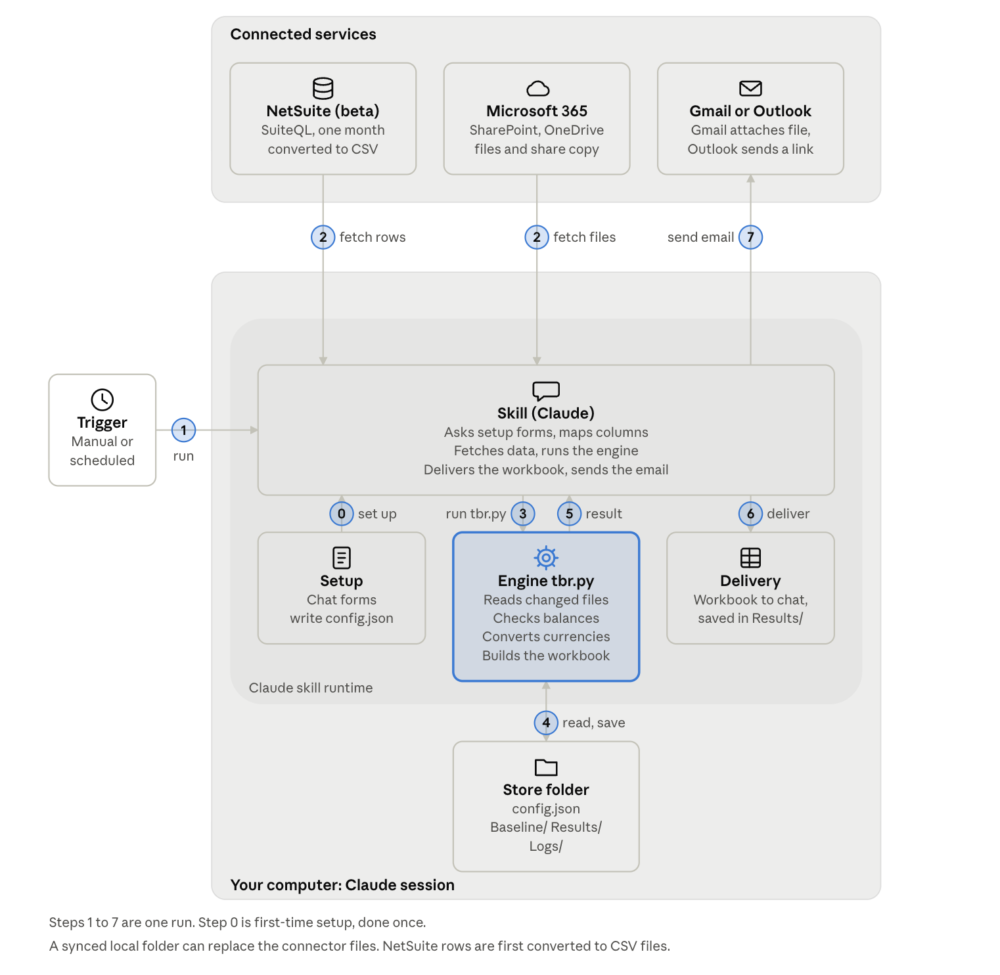
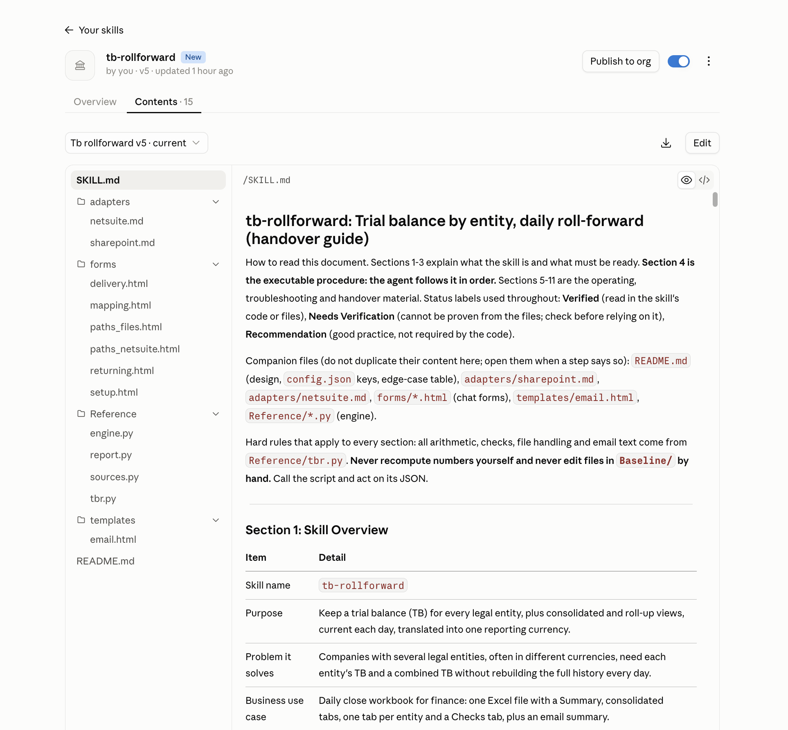
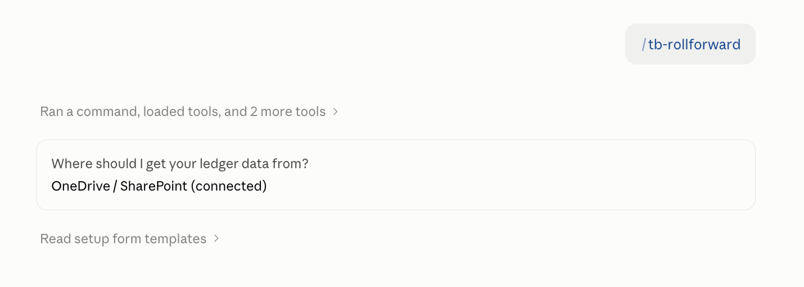
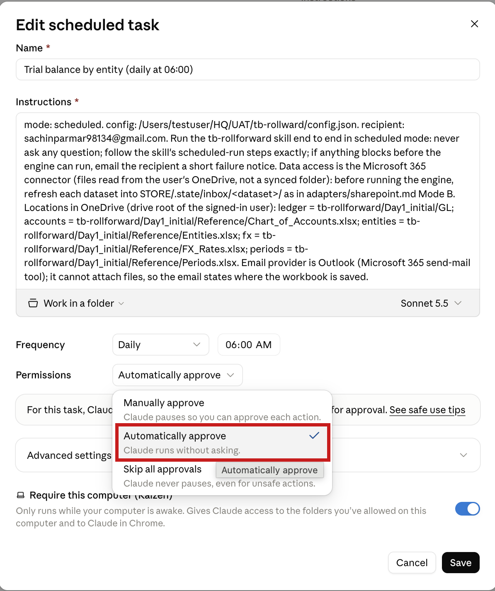

# Trial Balance Roll-Forward — Skill Overview and Setup Guide

*12 Oct 2026 · allNeurons*

## Overview

`tb-rollforward` keeps a trial balance for every legal entity, plus consolidated views, current each day in one reporting currency. It saves a locked snapshot of the last closed month (the baseline), adds only the months since then, writes an Excel workbook, and emails a summary.

| Item | Detail |
|---|---|
| Skill name | `tb-rollforward` |
| Runs | On demand in chat, or as a daily scheduled task |
| Data sources | Excel/CSV files (synced folder or OneDrive/SharePoint connector), or NetSuite (beta) |
| Output | Dated Excel workbook, updated baseline, run log, summary email (Gmail or Outlook) |
| Settings | Asked once in chat forms, stored in `config.json` in the user's folder |

---

## Problem statement

Companies with several legal entities, often in different currencies, need each entity's trial balance and a combined one — and rebuilding the full history every day is slow and error-prone.

- Each entity keeps books in its own currency, so figures must be translated to one reporting currency before they can be combined.
- Closed months should never be recalculated, yet new activity arrives daily.
- Source files change layout, and a wrong column or sign convention silently produces wrong totals.
- Finance teams want one workbook and one email each morning, without answering setup questions again.

---

## What the skill does

It turns raw ledger activity into a checked, translated trial balance and delivers it, with the engine script `tbr.py` doing all arithmetic and checks.

1. **Reads the data.** Ledger, chart of accounts, entities, FX rates and month status, from files or NetSuite. It maps your column headers once and never guesses afterwards.
2. **Builds a baseline.** A saved snapshot of balances up to the last closed month, checked against your books at setup.
3. **Rolls forward daily.** Adds closed months (the baseline advances) and open months (a `PRELIMINARY` workbook only), and skips work when nothing changed.
4. **Translates and checks.** Balance sheet at closing rates, profit and loss at average rates, equity at historical rates; differences show as a translation adjustment. Each entity must balance.
5. **Delivers.** One Excel workbook (Summary, consolidated tabs, one tab per entity, Checks), sent to chat and saved in your folder; Gmail attaches it, Outlook links a OneDrive/SharePoint copy.
6. **Logs and recovers.** One log line per run, a failure note when something breaks, and a one-step restore of the previous baseline.

**Out of scope:** explaining why an account moved, building full financial statements, multi-book accounting, intercompany eliminations, or non-12-month fiscal years.

---

## Architecture

A trigger starts the skill, which fetches data and hands it to one engine; the engine reads and saves the store folder and produces the workbook and email, whatever the source.

---

## Steps to install

[Download the skill](../daily%20close%20extract/Skill%20file/tb-rollforward.skill)

Install once: make the skill available, connect the tools it needs, attach a folder, and prepare your data. Setup itself then runs as chat forms.

**1. Make the skill available.**
Confirm `tb-rollforward` appears in your Claude (Cowork) skills list. It ships with `SKILL.md`, `README.md`, `Reference/` (the four engine scripts), `adapters/`, `forms/` and `templates/email.html`.

**2. Connect your data source.**
Microsoft 365 (SharePoint/OneDrive) for connector mode, a NetSuite SuiteQL connector for NetSuite mode (beta), or nothing extra for a synced folder.

**3. Connect an email provider.**
Gmail or Outlook. Outlook cannot attach files directly, so the skill also needs the SharePoint/OneDrive upload tool to link the workbook.

**4. Attach a store folder.**
In the Claude desktop app click **Add folder**. This folder holds `config.json`, `Baseline/`, `Results/`, `Logs/` and `Templates/`.

**5. Run first-time setup.**
Start the skill; it asks three things in order: where the data comes from, one combined settings form, then one form for column mapping and the last closed month. It then builds the baseline and asks you to confirm totals against your books.

**6. Warm up permissions and schedule.**
Approve each prompt with **Always allow**, let the skill create the daily scheduled task, and set that task's Permissions to **Automatically approve**.

> Keep the Claude app open at run time. A run missed while the computer was off starts on the next launch.

---

## How to run the skill

Run it from chat for the first time and for any manual run; after setup the scheduled task runs it daily without questions.

### First run (setup)

1. Start the skill in chat and attach your store folder.
2. Answer the three asks: data source, settings form, mapping form.
3. Confirm the baseline totals (assets, liabilities, equity, net income) against your books.
4. The skill runs once, sends the workbook into chat, saves it in `Results/<date>/`, and emails the recipient.
5. Approve the permission prompts and let it create the daily task.

### Manual run later

Start the skill on a configured folder and pick **Run now**. The menu also offers **Fix column mapping**, **Edit settings**, **Rebuild baseline**, and **Show status**.

### Daily scheduled run

The scheduled prompt contains `mode: scheduled`, so the skill never asks anything: it fetches data, runs `tbr.py run`, delivers the workbook, and emails the result. Failures email the exact error and change nothing.

---

## Check that it worked

| Check | Where |
|---|---|
| Last good run and baseline month | **Show status**, or `tbr.py status` |
| One line per run | `Logs/run_log.txt` |
| Today's workbook | `Results/<date>/TB_by_entity_<Mon_YYYY>_<timestamp>.xlsx` |
| Failure details | `RUN_FAILED_*.txt` and `EMAIL_FAILED_*.txt` in `Results/<date>/` |
| Scheduled task | Task list: enabled, next run, last run |

---

> **Note:** The daily scheduled run, the Outlook upload-and-link step, and the permission warm-up have not been tested end to end yet.

---

*Built by [allNeurons](https://allneurons.ai). Questions or feedback? Open an issue on this repo.*
